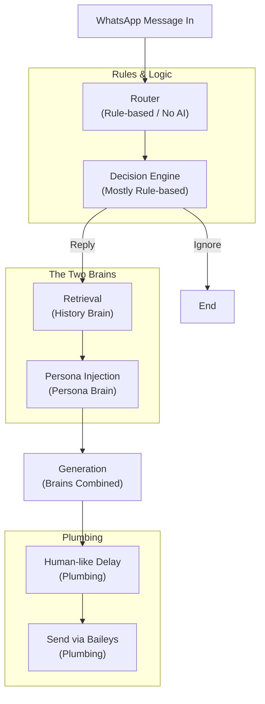

# Put Your WhatsApp on Cruise Control — Hands-Free Replies by an AI Agent using RAG

This project is an AI-powered WhatsApp automation system designed to handle conversations hands-free, providing context-aware, personalized replies.

## Architecture

### Architecture Notes

1. **Router:**
   "Looks up phone number in a table I maintain — no AI"

2. **Decision Engine:**
   "Cheap rules first, one AI call only if truly ambiguous"

3. **Retrieval:**
   "Searches only the matching relationship's memory (family/friend/professional/unknown)"

## Two-Brain Architecture
- **History Brain (Retrieval):** Manages the factual context and past conversation history, ensuring the agent remembers relevant details about interactions.
- **Persona Brain (Persona Injection):** Maintains your unique voice, tone, and preferences to ensure replies sound authentically like you.

## Roadmap
- **Week 1:** Project setup, architecture definition, and memory foundation.
- **Week 2:** Router, Decision Engine, and History/Persona retrieval implementation.
- **Week 3:** LLM generation, personality integration, and WhatsApp connectivity (Baileys).
- **Week 4:** Human-like delay, testing, and deployment.
