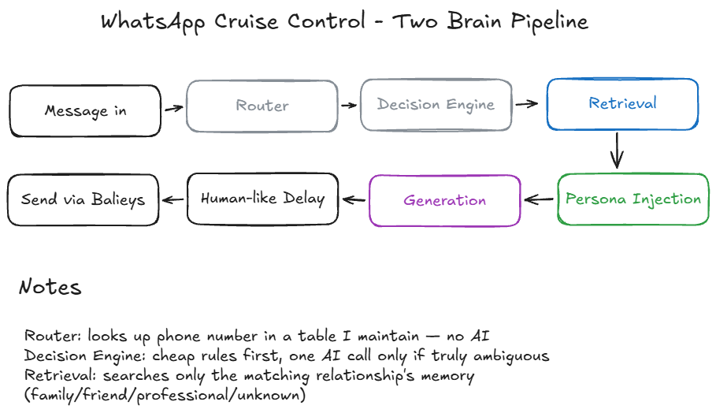

# WhatsApp AI Agent

A context-aware WhatsApp chatbot that generates personalized, human-like replies using memory and relationship context.



## Key Features

- **Persona-based replies**: Generates responses in your preferred style
- **Context-aware**: Uses conversation history and relationship context
- **Safety filters**: Automatically flags sensitive messages
- **Human-like delays**: Adds natural timing to replies
- **Multi-provider support**: Works with OpenAI, Gemini, Ollama, and local mock provider
- **Multilingual**: Supports multiple languages through E5 embeddings
- **Memory retrieval**: Uses ChromaDB for efficient memory storage and retrieval

## Architecture Flow

1. **Message Ingestion**: Receives messages via WhatsApp Baileys bridge
2. **Routing**: Determines sender relationship (friend, family, professional)
3. **Decision Engine**: Decides whether to reply, ignore, or flag for review
4. **Memory Retrieval**: Fetches relevant conversation history
5. **Generation**: Creates personalized response using selected LLM provider
6. **Delivery**: Sends reply with human-like delay

## How It Works

1. **Message Processing**:
   - Incoming messages are analyzed for content and sender context
   - The system determines the appropriate response strategy

2. **Context Building**:
   - Retrieves relevant conversation history from ChromaDB
   - Incorporates sender relationship into the response generation

3. **Response Generation**:
   - Uses selected LLM provider to create personalized reply
   - Applies persona settings for consistent style

4. **Safety Check**:
   - Scans for sensitive content (OTP, payment, passwords, etc.)
   - Flags messages requiring manual review if needed

5. **Delivery**:
   - Sends reply with calculated human-like delay
   - Logs all interactions for future reference

## Tech Stack

- **Backend**: Python (FastAPI, ChromaDB)
- **Frontend**: Node.js (Baileys WhatsApp library)
- **LLM Providers**: OpenAI, Google Gemini, Ollama
- **Embeddings**: Multilingual E5
- **Database**: ChromaDB
- **Deployment**: Local development environment

## Project Structure

```
WhatsApp-AI-Agent/
├── src/
│   ├── bridge_cli.py
│   ├── pipeline.py
│   ├── router.py
│   ├── decision_engine.py
│   ├── history_brain.py
│   ├── generator.py
│   └── delay.py
├── whatsapp/
│   └── index.js
├── config/
│   └── persona.md
├── docs/
│   └── architecture_diagram.png
├── chromadb_data/
├── auth_info_baileys/
├── README.md
└── requirements.txt
```

## Setup Instructions

### Python Dependencies

```bash
pip install -r requirements.txt
```

### Node Dependencies

```bash
cd whatsapp
npm install
```

### Environment Variables

Create a `.env` file with:

```
OPENAI_API_KEY=your_openai_key
GEMINI_API_KEY=your_gemini_key
```

### WhatsApp Connection

1. Run the WhatsApp bridge:
   ```bash
   cd whatsapp
   node index.js
   ```
2. Scan the QR code with your WhatsApp app
3. The bridge will connect to your WhatsApp account

## Running the Project

1. Start the WhatsApp bridge (as above)
2. In another terminal, run the Python pipeline:
   ```bash
   python src/bridge_cli.py
   ```
3. Send a message to your connected WhatsApp number
4. The AI agent will process and reply automatically

## Example Conversations

### Normal Conversation

**You**: Hey, what's up?
**AI Agent**: Not much! Just here and ready to chat. How about you?

### Sensitive Message

**You**: Here's your OTP: 123456
**AI Agent**: [Manual review required]

## Privacy and Security

- **No API keys committed**: Never commit API keys or sensitive credentials
- **No WhatsApp auth sessions committed**: Keep WhatsApp session data local
- **No ChromaDB runtime data committed**: Database files are for local use only
- **No private chat exports committed**: Conversation data remains private

## Important Note

**Never commit**:
- API keys
- WhatsApp auth sessions
- ChromaDB runtime data
- Private chat exports

## Supported LLM Providers

- OpenAI
- Google Gemini
- Ollama
- MockProvider (for testing)

## Testing

Run the test suite with:

```bash
python -m pytest
```

## Limitations

- Requires a WhatsApp account for testing
- Limited to personal use (not for business messaging)
- Memory retrieval may be slow with large conversation histories

## Future Improvements

- Add support for group chats
- Implement more sophisticated memory management
- Add voice message processing
- Develop a web interface for configuration

## License

[MIT License](LICENSE)
